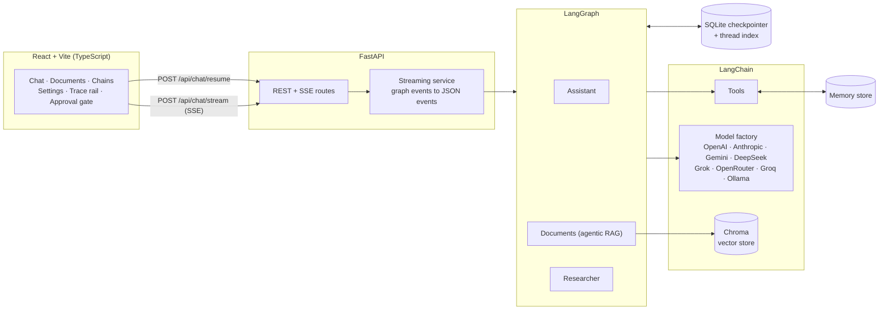
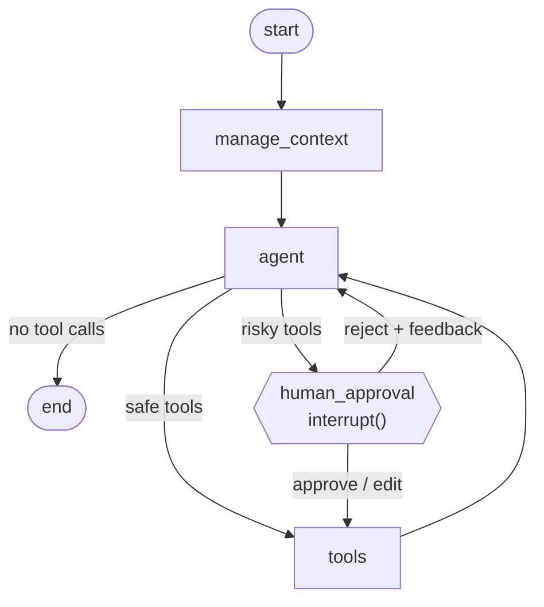
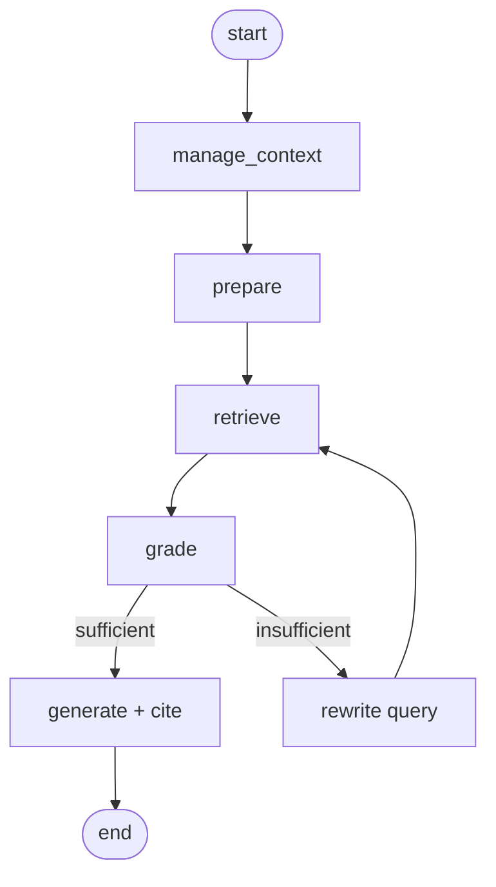
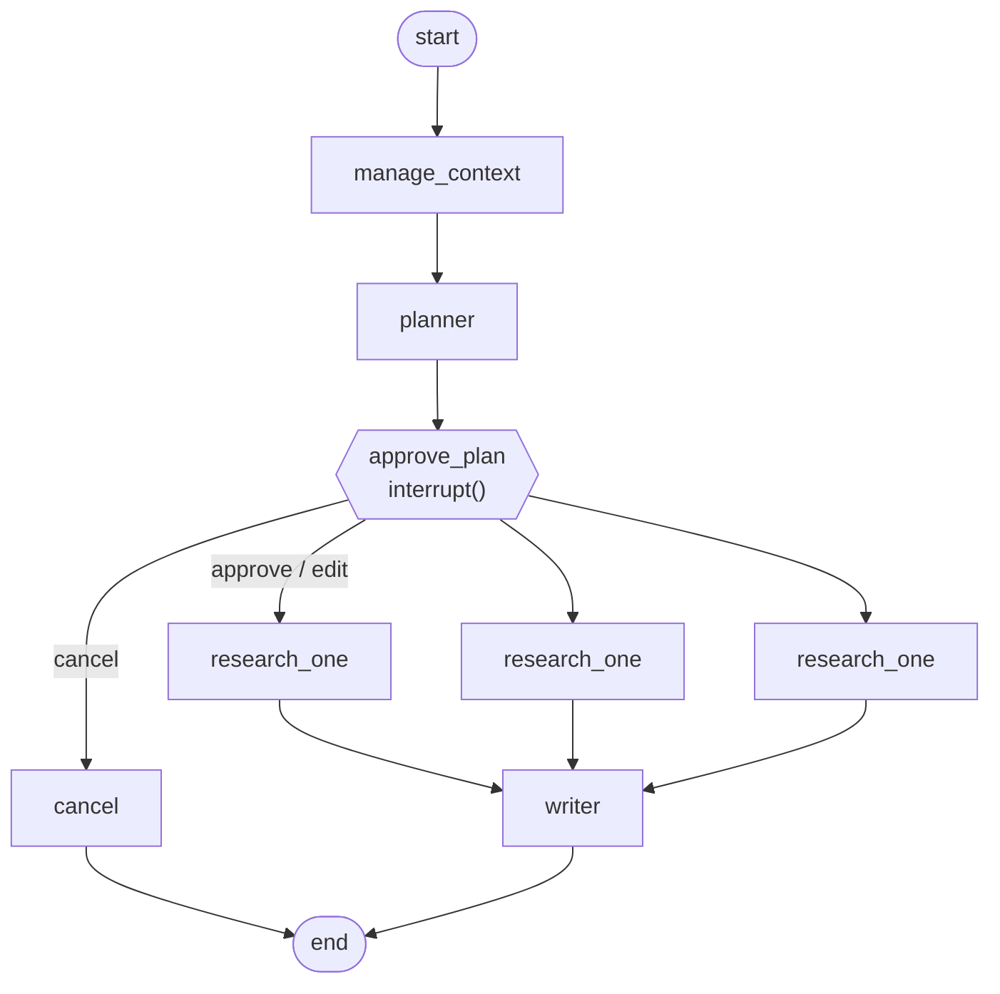

<div align="center">

# LangChain AI Project

**A production-style reference for building AI applications with LangChain and LangGraph: multi-provider chat, agentic RAG, tool use, human-in-the-loop approvals and long-conversation context management, behind a FastAPI backend and a React UI.**

[](https://github.com/javaidgithub/langchain-ai-project/actions/workflows/ci.yml)


[](https://javaidgithub.github.io/langchain-ai-project)

</div>
> 📚 **[Full Documentation →](https://javaidgithub.github.io/langchain-ai-project)**
---

## Contents

- [Features](#features)
- [Architecture](#architecture)
- [Quick start](#quick-start)
- [Configuration](#configuration)
- [The three agents](#the-three-agents)
- [Human-in-the-loop](#human-in-the-loop)
- [Context management](#context-management)
- [Tools](#tools)
- [LangChain concepts covered](#langchain-concepts-covered)
- [API reference](#api-reference)
- [Project structure](#project-structure)
- [Extending the project](#extending-the-project)
- [Testing](#testing)
- [Security notes](#security-notes)
- [Deployment](#deployment)
- [Troubleshooting](#troubleshooting)
- [License](#license)

## Features

| Area | What you get |
| --- | --- |
| **Multi-provider models** | OpenAI, Anthropic, Google Gemini, DeepSeek, xAI Grok, OpenRouter, Groq and Ollama behind one factory. Switch provider and model per request from the UI; type any model id. |
| **LangGraph agents** | Three graphs: a tool-using **Assistant**, an agentic-RAG **Documents** agent (retrieve, grade, rewrite, answer with citations) and a **Researcher** (plan, human approval, parallel workers, report). |
| **Human-in-the-loop** | Graphs pause with `interrupt()` before risky tools or before research starts. You can approve, edit the arguments or plan, or reject with feedback. Pauses survive page reloads and server restarts. |
| **Tools** | 14 tools: web search, Wikipedia, URL fetch, weather, calculator, time, document search, long-term memory, sandboxed files, Python execution and (simulated) email. |
| **Context management** | Automatic summarization of old turns, a token-bounded prompt window, tool-call-safe trimming, and a cross-thread long-term memory store. |
| **RAG** | Upload PDF, text, Markdown, CSV or JSON. Chunking, embeddings (OpenAI, Google, Ollama or local HuggingFace), Chroma vector store, MMR retrieval, cited answers. |
| **LCEL playground** | Five runnable chains (summarize, translate, structured extraction, parallel analysis, routing) you can try in the UI and read in one file. |
| **Streaming UI** | Token streaming over Server-Sent Events. Every tool call and graph step appears live on a trace rail beside the answer. |
| **Persistence** | SQLite checkpointer for conversation state and a SQLite thread index. Long-term memory uses an in-memory store by default. Postgres is the documented path for production. |
| **Observability** | Token usage callback, structured logs and optional LangSmith tracing. |
| **Engineering** | Typed end to end, 20 backend tests that run the real graphs with a scripted model (no API keys needed), CI, Docker, Makefile. |

## Architecture



**How a run works.** The browser posts a message. The API picks the graph for the thread's agent, injects the selected model and options into the run config, and streams `graph.astream(...)` back as small JSON events. If the graph reaches an `interrupt()`, the stream ends with an `interrupt` event and the run is checkpointed. The UI shows the approval gate; the decision is posted to `/api/chat/resume`, which continues the same run with `Command(resume=decision)`. See [docs/ARCHITECTURE.md](docs/ARCHITECTURE.md) for the event protocol and design decisions.

## Quick start

### Prerequisites

- Python 3.11+ and Node.js 20+ (or just Docker)
- An API key for at least one provider, or [Ollama](https://ollama.com) running locally (no key needed)

### Run locally

```bash
git clone https://github.com/javaidgithub/langchain-ai-project.git
cd langchain-ai-project

make setup          # creates .env, a Python venv and installs both stacks
# edit .env and add at least one provider key (or paste a key later in the UI)

make backend        # terminal 1: API on http://localhost:8000  (docs at /docs)
make frontend       # terminal 2: UI  on http://localhost:5173
```

<details>
<summary>Without <code>make</code></summary>

```bash
cp .env.example .env

cd backend
python3 -m venv .venv && source .venv/bin/activate
pip install -r requirements.txt
uvicorn app.main:app --reload --port 8000

# in another terminal
cd frontend
npm install
npm run dev
```
</details>

### Run with Docker

```bash
cp .env.example .env     # add your keys
docker compose up --build
```

Open **http://localhost:8080**. The frontend container serves the UI and proxies `/api` to the backend, with buffering disabled so streaming works.

### Try it

1. Open Settings, pick a provider and model.
2. In **Assistant**, ask: *"Email team@example.com a short summary of today's priorities."* The agent will pause with an approval gate. Edit the message, then approve.
3. Upload a PDF in **Documents**, switch to the **Documents** agent and ask about it. Sources are cited under the answer.
4. Try **Researcher** with *"Compare vector databases for production RAG"*. Review the plan, edit a step and start.

## Configuration

All settings are environment variables (see [`.env.example`](.env.example) for the full annotated list). Key ones:

| Variable | Default | Purpose |
| --- | --- | --- |
| `OPENAI_API_KEY`, `ANTHROPIC_API_KEY`, `GOOGLE_API_KEY`, `DEEPSEEK_API_KEY`, `XAI_API_KEY`, `OPENROUTER_API_KEY`, `GROQ_API_KEY` | none | Provider keys. All optional; users can also paste a key in the UI. |
| `OLLAMA_BASE_URL` | `http://localhost:11434` | Local models. |
| `DEFAULT_PROVIDER`, `DEFAULT_MODEL` | `openai`, `gpt-4o-mini` | Used when a request omits them. |
| `EMBEDDINGS_PROVIDER` | `openai` | `openai`, `google`, `ollama` or `huggingface`. No OpenAI key? Use `ollama` or `huggingface`. |
| `CHECKPOINTER` | `sqlite` | `sqlite` (persistent) or `memory` (ephemeral). |
| `MAX_CONTEXT_TOKENS` | `6000` | Token budget before old turns are summarized. |
| `KEEP_LAST_MESSAGES` | `6` | Recent messages kept verbatim after summarizing. |
| `API_AUTH_TOKEN` | empty | When set, every `/api` call needs `Authorization: Bearer <token>`. |
| `LANGSMITH_TRACING`, `LANGSMITH_API_KEY` | off | Enable LangSmith tracing. |

> **Model ids change often.** The dropdown suggestions live in [`backend/app/llm/catalog.py`](backend/app/llm/catalog.py). Edit that list, or just type any id your provider supports.

### Provider notes

| Provider | Package | Notes |
| --- | --- | --- |
| OpenAI | `langchain-openai` | |
| Anthropic | `langchain-anthropic` | |
| Google Gemini | `langchain-google-genai` | Uses `GOOGLE_API_KEY`. |
| DeepSeek | `langchain-deepseek` | `deepseek-reasoner` streams its reasoning into a collapsible block; it has historically not supported tool calling, so check your provider's docs and use it with the Documents or Researcher agents or with tools turned off. |
| xAI Grok | `langchain-xai` | |
| OpenRouter | `langchain-openai` | OpenAI-compatible endpoint. Model ids look like `vendor/model`. |
| Groq | `langchain-groq` | |
| Ollama | `langchain-ollama` | Pick a model that supports tool calling for the Assistant. |

Providers are imported lazily, so you can remove any package you don't use from `requirements.txt`.

## The three agents

### Assistant

A tool-calling ReAct-style loop with approval for risky tools and automatic context management.



### Documents (agentic RAG)

Retrieval that checks its own work. If the retrieved chunks do not answer the question, the query is rewritten and retried (at most twice) before answering with citations.



### Researcher

Plan, get approval, fan out in parallel with `Send`, then write the report.



## Human-in-the-loop

Nodes call `interrupt(payload)`. LangGraph checkpoints the run and returns control to the API; the client later resumes it with `Command(resume=decision)`, and `interrupt()` returns that decision inside the node.

**Tool approval** (`type: "tool_approval"`):

```jsonc
// interrupt payload sent to the UI
{ "type": "tool_approval", "tool_calls": [{ "id": "call_1", "name": "send_email", "args": { "to": "a@b.com", "subject": "Hi", "body": "..." } }] }

// decisions the UI can send to POST /api/chat/resume  ({ ..., "decision": <one of these> })
{ "action": "approve" }
{ "action": "edit",   "edited_args": { "call_1": { "to": "a@b.com", "subject": "Hi", "body": "Edited text" } } }
{ "action": "reject", "feedback": "Don't email that address" }
```

**Plan approval** (`type: "plan_approval"`): decisions are `approve`, `edit` with a `plan` array, or `cancel`.

- A tool needs approval when its `ToolSpec` has `requires_approval=True` in [`tools/registry.py`](backend/app/tools/registry.py). By default: `send_email`, `python_repl`, `write_file`.
- Rejecting tells the model what happened (via a `ToolMessage`), so it can respond sensibly instead of retrying.
- Because state lives in the checkpointer, a pending approval **survives a page reload**: `GET /api/threads/{id}` returns it and the UI re-shows the gate.
- The "Ask before risky actions" switch in Settings turns approval off per request.

## Context management

Long conversations are handled in three layers ([`agents/context.py`](backend/app/agents/context.py)):

1. **Summarize.** Before each turn, if the history exceeds `MAX_CONTEXT_TOKENS`, older messages are folded into a running `summary` in graph state and removed with `RemoveMessage`. The last `KEEP_LAST_MESSAGES` stay verbatim. The split always lands on a human turn so a tool call is never separated from its result (providers reject orphaned tool messages).
2. **Inject.** The summary is added to the system prompt on every model call.
3. **Trim.** `trim_messages` hard-limits what is actually sent, as a safety net.

For facts that should outlive a conversation, the Assistant has `save_memory` and `search_memory` tools backed by a LangGraph `BaseStore`, namespaced per user. Saved memories are visible and deletable in Settings. The default store is in-memory; swap it for a Postgres-backed store for durability (see [docs/ARCHITECTURE.md](docs/ARCHITECTURE.md)).

## Tools

| Tool | Category | Needs approval | Notes |
| --- | --- | :---: | --- |
| `web_search` | web | | DuckDuckGo via `ddgs`, no key needed |
| `wikipedia` | web | | Intro of the best-matching article |
| `fetch_url` | web | | Readable text of a public page; blocks private and local addresses |
| `get_weather` | web | | Open-Meteo, no key needed |
| `calculator` | utility | | AST-based evaluator, no `eval` |
| `get_current_datetime` | utility | | Any IANA timezone |
| `search_knowledge_base` | knowledge | | Searches your uploaded documents |
| `save_memory` / `search_memory` | memory | | Long-term store, per user |
| `list_files` / `read_file` | files | | Confined to `data/workspace` |
| `write_file` | files | **yes** | Confined to `data/workspace` |
| `python_repl` | code | **yes** | Subprocess with timeout. **Not a security sandbox** |
| `send_email` | communication | **yes** | Simulated: appends to `data/workspace/outbox.jsonl` |

## LangChain concepts covered

| Concept | Where to look |
| --- | --- |
| Chat model abstraction across providers | [`llm/factory.py`](backend/app/llm/factory.py) |
| Prompt templates | [`chains/lcel.py`](backend/app/chains/lcel.py), [`agents/prompts.py`](backend/app/agents/prompts.py) |
| Output parsers | `StrOutputParser` in [`chains/lcel.py`](backend/app/chains/lcel.py) |
| Structured output (Pydantic) | [`chains/lcel.py`](backend/app/chains/lcel.py) (`Entities`, `Sentiment`), [`rag_agent.py`](backend/app/agents/rag_agent.py) (`Grade`), [`research.py`](backend/app/agents/research.py) (`Plan`) |
| LCEL: pipe, `RunnableParallel`, `RunnableBranch`, `RunnableLambda` | [`chains/lcel.py`](backend/app/chains/lcel.py) |
| Retries and fallbacks (`with_retry`, `with_fallbacks`) | `with_resilience` helper in [`chains/lcel.py`](backend/app/chains/lcel.py) |
| Tools, argument schemas, injected state | [`tools/`](backend/app/tools) (`InjectedStore` in `memory.py`) |
| Tool calling (`bind_tools`) and `ToolNode` | [`agents/assistant.py`](backend/app/agents/assistant.py) |
| Document loaders and text splitters | [`rag/service.py`](backend/app/rag/service.py) |
| Embeddings and vector stores | [`rag/embeddings.py`](backend/app/rag/embeddings.py), Chroma in `rag/service.py` |
| Retrievers (MMR) and RAG chains with citations | `get_retriever`, `rag_chain` |
| Short-term memory (checkpointer) | [`services/checkpointer.py`](backend/app/services/checkpointer.py) |
| Long-term memory (store) | [`tools/memory.py`](backend/app/tools/memory.py) |
| Message trimming and summarization | [`agents/context.py`](backend/app/agents/context.py) |
| Callbacks | [`callbacks/usage.py`](backend/app/callbacks/usage.py) |
| LLM caching | `ENABLE_LLM_CACHE` in [`main.py`](backend/app/main.py) |
| Streaming (tokens and graph updates) | [`services/streaming.py`](backend/app/services/streaming.py) |
| LangGraph: state, reducers, conditional edges, `Command`, `interrupt`, `Send` | [`agents/`](backend/app/agents) |
| Tracing | LangSmith settings in [`core/config.py`](backend/app/core/config.py) |

Not included yet, but a natural next step: MCP tool servers, hybrid (BM25 + vector) retrieval, reranking and an evaluation harness.

## API reference

Interactive docs are served at `http://localhost:8000/docs`.

| Method | Path | Description |
| --- | --- | --- |
| `GET` | `/api/health` | Liveness (no auth) |
| `GET` | `/api/models` | Providers, suggested models and whether a server key is set |
| `GET` | `/api/tools` | Tool catalog with approval flags |
| `GET` | `/api/agents` | Available agents |
| `POST` | `/api/chat/stream` | Send a message; responds with an SSE stream |
| `POST` | `/api/chat/resume` | Resume a paused run with a decision; SSE stream |
| `GET` | `/api/threads` | List conversations |
| `GET` | `/api/threads/{id}` | History, summary and any pending interrupt |
| `PATCH` / `DELETE` | `/api/threads/{id}` | Rename / delete |
| `POST` | `/api/rag/upload` | Upload and index a document |
| `GET` / `DELETE` | `/api/rag/documents[/{name}]` | List / remove indexed documents |
| `POST` | `/api/rag/query` | One-shot cited answer using an LCEL chain |
| `GET` / `POST` | `/api/chains`, `/api/chains/{name}` | List / run an LCEL chain |
| `GET` / `DELETE` | `/api/memory[/{id}]` | Inspect / delete long-term memories |

`POST /api/chat/stream` body:

```json
{
  "message": "Compare SQLite and Postgres for a small SaaS",
  "thread_id": null,
  "agent": "assistant",
  "model": { "provider": "openrouter", "model": "deepseek/deepseek-chat", "temperature": 0.2, "api_key": null },
  "enabled_tools": null,
  "require_approval": true,
  "system_prompt": null
}
```

Stream events are documented in [docs/ARCHITECTURE.md](docs/ARCHITECTURE.md#stream-events).

## Project structure

```
langchain-ai-project/
├── backend/
│   ├── app/
│   │   ├── main.py                # FastAPI app + lifespan (graphs, checkpointer, store)
│   │   ├── core/                  # settings, logging, errors, auth, request context
│   │   ├── api/                   # router, dependencies, route modules
│   │   ├── schemas/               # Pydantic request models
│   │   ├── llm/                   # provider catalog + chat model factory
│   │   ├── agents/                # LangGraph graphs: assistant, rag_agent, research
│   │   │   ├── context.py         # summarization + trimming
│   │   │   └── prompts.py
│   │   ├── tools/                 # tool implementations + registry
│   │   ├── rag/                   # embeddings, ingestion, retrieval
│   │   ├── chains/                # LCEL chains
│   │   ├── callbacks/             # usage / timing callback
│   │   └── services/              # SSE streaming, checkpointer, thread repository
│   ├── tests/                     # pytest, scripted fake model (no API keys)
│   ├── requirements.txt
│   └── Dockerfile
├── frontend/
│   └── src/
│       ├── api/                   # typed client + SSE parser
│       ├── store/                 # Zustand stores (settings, chat, catalog)
│       ├── hooks/chatActions.ts   # stream events to UI state, pause and resume
│       ├── components/            # Chat, Trace rail, ApprovalGate, Inspector, ...
│       └── styles/global.css
├── docs/ARCHITECTURE.md
├── docker-compose.yml
├── Makefile
├── .env.example
└── .github/workflows/ci.yml
```

## Extending the project

### Add a tool

```python
# backend/app/tools/hello.py
from langchain_core.tools import tool

@tool
def shout(text: str) -> str:
    """Return the text in upper case."""   # the docstring is what the model reads
    return text.upper()
```

Register it in [`tools/registry.py`](backend/app/tools/registry.py):

```python
ToolSpec(shout, "utility"),                          # runs automatically
ToolSpec(shout, "utility", requires_approval=True),  # pauses for a human first
```

Then add a friendly label in `frontend/src/lib/labels.ts` (optional). It appears in Settings automatically.

### Add a provider

1. Add a `ProviderSpec` in [`llm/catalog.py`](backend/app/llm/catalog.py).
2. Add a branch in [`llm/factory.py`](backend/app/llm/factory.py). For OpenAI-compatible APIs this is `ChatOpenAI(base_url=..., api_key=...)`, exactly like OpenRouter.
3. Add `<PROVIDER>_API_KEY` to `Settings` and `provider_keys` in [`core/config.py`](backend/app/core/config.py).

### Add an agent

1. Build a `StateGraph` in `backend/app/agents/` and compile it with the shared `checkpointer` and `store`.
2. Register it in [`agents/registry.py`](backend/app/agents/registry.py) with the node names whose tokens should stream to the user.
3. Add the id to `AgentName` in [`schemas/chat.py`](backend/app/schemas/chat.py) and `AgentId` in `frontend/src/api/types.ts`.

## Testing

```bash
make test        # backend pytest + frontend type check
make lint        # ruff
```

The backend tests drive the **real graphs through the real HTTP and SSE layer** using a scripted fake chat model, so they need no API keys or network. They cover safe tool execution, pause/approve/edit/reject, approval disabled, state surviving reload, thread history and deletion, plan approval with parallel workers, the RAG rewrite loop, context splitting and tool safety (calculator injection attempts, path traversal).

## Security notes

This is a reference implementation. Before exposing it publicly:

- **Set `API_AUTH_TOKEN`** and put the app behind HTTPS. Without it the API is open to anyone who can reach it.
- **API keys pasted in the UI** are stored in the browser's `localStorage` and sent with requests. They are held in a request-scoped context variable and are never written to the database or checkpoints. If that trade-off is not acceptable for your users, remove the key field and use server-side keys only.
- **`python_repl` is not a sandbox.** Approval plus a timeout is not isolation. Run it in a container, gVisor or a hosted sandbox (for example E2B), or remove the tool.
- **`fetch_url`** refuses private and loopback addresses, but redirects are followed. Add an egress allow-list for strict environments.
- **Uploads** are limited by size and type, parsed in-process, and deleted after indexing.
- Per-user isolation is only by `user_id` namespace for memory. Add real authentication and map it to `user_id` and thread ownership before multi-tenant use.

## Deployment

- **Docker Compose** (included) is suitable for a single host. Data persists in the `app-data` volume.
- **Scaling out.** SQLite is single-instance. For multiple replicas use `langgraph-checkpoint-postgres` for the checkpointer and a Postgres store for memory, and move the thread index table to the same database. See [docs/ARCHITECTURE.md](docs/ARCHITECTURE.md#scaling-out).
- Serve the frontend as static files (the Dockerfile uses nginx). Behind any proxy, **disable response buffering** for `/api` or streaming will stall.

## Troubleshooting

| Symptom | Fix |
| --- | --- |
| "Can't reach the backend" banner | Start the API (`make backend`). In production set `VITE_API_URL` at build time. |
| "No API key for ..." | Add the key to `.env`, or paste it in Settings. |
| Uploading documents fails with an embeddings error | `EMBEDDINGS_PROVIDER=openai` needs `OPENAI_API_KEY`. Use `ollama` (pull `nomic-embed-text`) or `huggingface` (`pip install langchain-huggingface sentence-transformers`). |
| Streaming appears all at once | A proxy is buffering. Disable buffering for `/api` (see `frontend/nginx.conf`). |
| Tool calls fail with a "does not support tools" error | The chosen model has no tool calling (for example `deepseek-reasoner`). Pick another model or disable tools. |
| Existing chat refuses a different agent | A thread is bound to one agent. Start a new chat to switch. |

## License

Released under the [MIT License](LICENSE).
