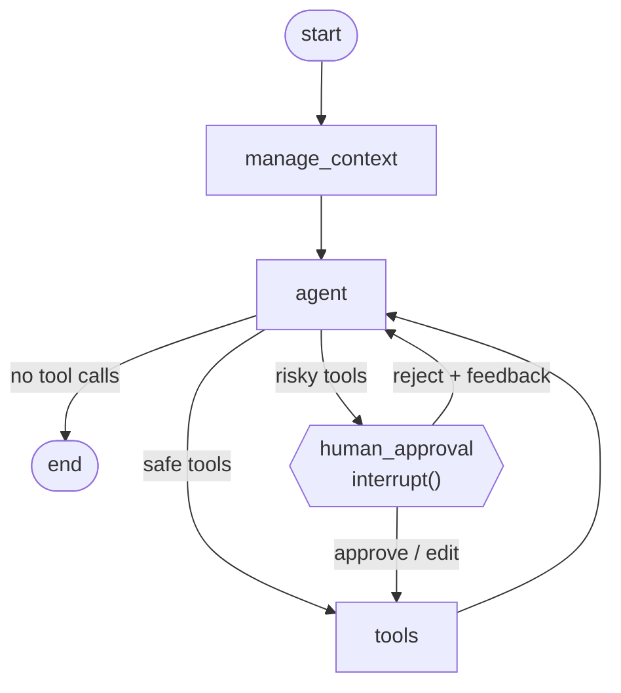
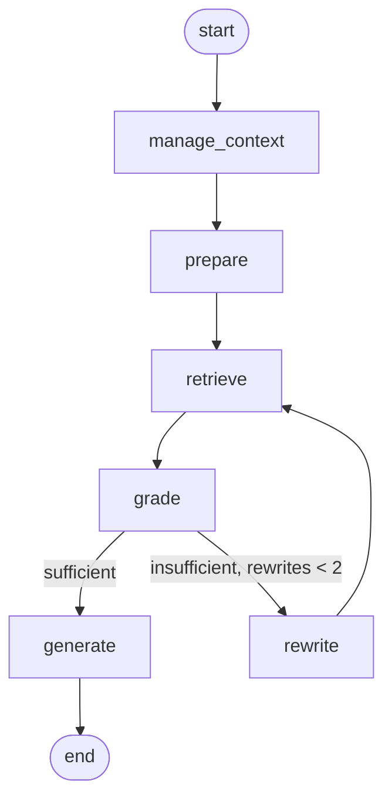
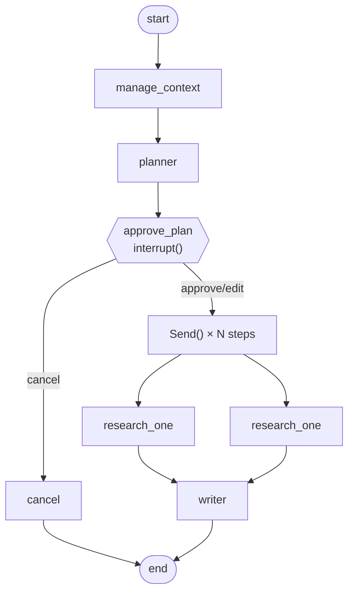

# LangGraph Agents

LangGraph is LangChain's framework for building stateful, multi-step agent graphs. Where LCEL chains are linear pipelines, LangGraph graphs can loop, branch, pause for human input and fan out in parallel.

**Source files:** `backend/app/agents/`

---

## Core concepts

### State

Every graph has a `State` TypedDict. Nodes read from it and return updates to it. LangGraph merges updates automatically using *reducers*.

```python
from langgraph.graph import MessagesState

class AgentState(MessagesState):
    # MessagesState provides `messages: Annotated[list[AnyMessage], add_messages]`
    # add_messages reducer appends new messages rather than replacing the list
    summary: str   # our addition: a rolling summary of older turns
```

### Nodes

Nodes are `async def` functions that take the state and return a dict of updates:

```python
async def agent_node(state: AgentState, config: RunnableConfig) -> dict:
    llm = get_chat_model(...)
    response = await llm.bind_tools(tools).ainvoke(messages, config)
    return {"messages": [response]}   # appended by the add_messages reducer
```

### Edges

Edges connect nodes. Conditional edges choose the next node at runtime:

```python
graph.add_conditional_edges(
    "agent",
    route_after_agent,   # function that returns a node name or END
    {"tools": "tools", "human_approval": "human_approval", END: END},
)
```

### Compilation and persistence

```python
graph = builder.compile(
    checkpointer=checkpointer,   # SQLite: conversations survive restarts
    store=store,                 # cross-thread long-term memory
)
```

---

## The Assistant graph



- `manage_context` — summarizes if the history is too long.
- `agent` — calls the model with bound tools.
- `tools` — `ToolNode` runs all safe tool calls in parallel.
- `human_approval` — pauses with `interrupt()` for risky tools.

---

## The Documents (agentic RAG) graph



- `grade` — asks the model if the retrieved docs answer the question.
- `rewrite` — if not, rewrites the query and retrieves again (max 2 rewrites).
- `generate` — answers with inline citations.

---

## The Researcher graph



`Send` is LangGraph's way to fan out: it creates one instance of `research_one` per plan step, all running in parallel, with their own input payload. The `findings` reducer (a custom `Annotated` field) appends results from all workers.

---

## Run configuration

Every graph is compiled once at startup. Per-request options (model, tools, approval toggle) are passed through `config["configurable"]` and read by `AgentConfig`:

```python
cfg = AgentConfig.from_config(config)
llm = get_chat_model(cfg.provider, cfg.model, cfg.temperature)
```

This means **one compiled graph serves every provider and model combination** — no restart needed to switch.

---

## Scaling out

SQLite is single-process. For multiple replicas:

```python
# services/checkpointer.py
from langgraph.checkpoint.postgres.aio import AsyncPostgresSaver
async with AsyncPostgresSaver.from_conn_string(database_url) as saver:
    await saver.setup()
    yield saver
```

Install `langgraph-checkpoint-postgres` and `psycopg[binary,pool]`.
