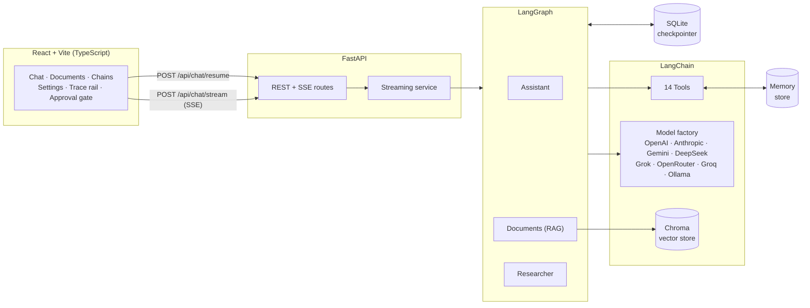

<div align="center" markdown>

# 🔗 LangChain AI Project

**A production-ready, full-stack AI agent platform — multi-provider LLMs, agentic RAG, human-in-the-loop approvals, 14 tools, context management, and a streaming React UI.**

[](https://github.com/javaidgithub/langchain-ai-project)
[](https://python.org)
[](https://python.langchain.com)
[](https://langchain-ai.github.io/langgraph)
[](https://fastapi.tiangolo.com)
[](https://react.dev)
[](https://github.com/javaidgithub/langchain-ai-project/blob/main/LICENSE)

[Get Started](guides/quickstart.md){ .md-button .md-button--primary }
[View on GitHub](https://github.com/javaidgithub/langchain-ai-project){ .md-button }

</div>

---

## What is this project?

This is a **fully working, deeply documented reference implementation** for building production AI applications with the LangChain ecosystem. It is not a toy — it is a boilerplate you clone, configure with your API keys, and run. Every file is written to be readable, so you can understand the pattern and adapt it to your own product.

---

## Feature highlights

<div class="grid cards" markdown>

-   :robot_face: **Three LangGraph Agents**

    ---

    A tool-using **Assistant**, an agentic **Documents** agent that retrieves, grades, rewrites and cites, and a **Researcher** that plans, gets your approval, researches steps in parallel, then writes a report.

    [:octicons-arrow-right-24: The three agents](concepts/langgraph-agents.md)

-   :busts_in_silhouette: **Human-in-the-Loop**

    ---

    The graph pauses with `interrupt()` before sending emails, running code, writing files, or starting research. You approve, edit the arguments, or reject with feedback — and the pause survives a page reload.

    [:octicons-arrow-right-24: How HITL works](concepts/human-in-the-loop.md)

-   :globe_with_meridians: **8 LLM Providers**

    ---

    OpenAI, Anthropic, Google Gemini, DeepSeek, xAI Grok, OpenRouter, Groq and Ollama behind one factory. Switch provider and model per conversation from the UI — no restart needed.

    [:octicons-arrow-right-24: Provider guide](concepts/providers.md)

-   :books: **Agentic RAG**

    ---

    Upload PDF, Markdown, CSV or JSON. Chunks are embedded (OpenAI, Google, Ollama or local HuggingFace), stored in Chroma, retrieved with MMR, graded for relevance, and cited in the answer.

    [:octicons-arrow-right-24: RAG deep dive](concepts/rag.md)

-   :chains: **LCEL Playground**

    ---

    Five runnable chains you can try in the UI: summarize, translate, structured extraction (Pydantic), parallel analysis (RunnableParallel), and routing (RunnableBranch). All in one file.

    [:octicons-arrow-right-24: LCEL chains](concepts/lcel-chains.md)

-   :brain: **Context Management**

    ---

    Older turns are automatically summarized into a rolling `summary` field and removed from the history. The last N messages stay verbatim. Token trimming acts as a safety net. All three agents share this.

    [:octicons-arrow-right-24: Context management](concepts/context-management.md)

-   :zap: **Streaming UI**

    ---

    Tokens stream over Server-Sent Events. Every tool call and agent step appears live on a "trace rail" alongside the answer. The approval gate uses a saffron highlight so it is impossible to miss.

    [:octicons-arrow-right-24: Streaming internals](concepts/streaming.md)

-   :wrench: **14 Built-in Tools**

    ---

    Web search, Wikipedia, URL fetch, weather, calculator, datetime, document search, save/search memory, list/read/write files, Python REPL, and simulated email — all discoverable in the UI.

    [:octicons-arrow-right-24: Tool catalog](concepts/tools.md)

</div>

---

## Architecture at a glance



---

## LangChain concepts covered

| Concept | Where |
|---|---|
| Chat models across 8 providers | `llm/factory.py` |
| Prompt templates | `agents/prompts.py`, `chains/lcel.py` |
| Output parsers | `chains/lcel.py` |
| Structured output (Pydantic) | `chains/lcel.py`, `agents/rag_agent.py`, `agents/research.py` |
| LCEL: pipe, `RunnableParallel`, `RunnableBranch`, `RunnableLambda` | `chains/lcel.py` |
| Retries and fallbacks | `chains/lcel.py` — `with_resilience()` |
| Tool calling, `bind_tools`, `ToolNode` | `agents/assistant.py` |
| Document loaders, text splitters | `rag/service.py` |
| Embeddings and Chroma vector store | `rag/embeddings.py`, `rag/service.py` |
| MMR retrieval and cited RAG | `rag/service.py` |
| Short-term memory (checkpointer) | `services/checkpointer.py` |
| Long-term memory (store, `InjectedStore`) | `tools/memory.py` |
| Message trimming and summarization | `agents/context.py` |
| Callbacks — token usage, timing | `callbacks/usage.py` |
| LLM caching | `main.py` — `ENABLE_LLM_CACHE` |
| Streaming — tokens and graph updates | `services/streaming.py` |
| LangGraph — state, reducers, `Command`, `interrupt`, `Send` | `agents/` |
| LangSmith tracing | `core/config.py` |

---

## Quick start

```bash
git clone https://github.com/javaidgithub/langchain-ai-project.git
cd langchain-ai-project
make setup          # create .env, install backend + frontend deps
# edit .env and add at least one provider key
make backend        # API on :8000
make frontend       # UI  on :5173
```

Or with Docker in one command:

```bash
cp .env.example .env   # add your keys
docker compose up --build
# open http://localhost:8080
```

[:octicons-arrow-right-24: Full setup guide](guides/quickstart.md)
